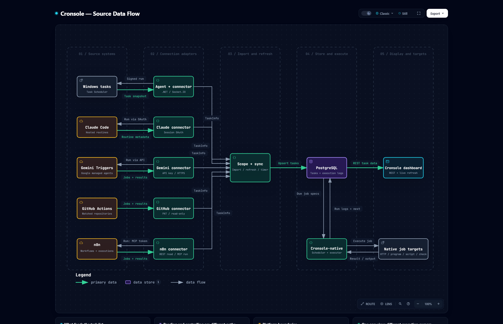

<h1 align="center">🧭 Diagrams</h1>

<p align="center">
  <em>Where Cronsole's task data comes from and where it goes, drawn from the code and checked against it.</em>
</p>

<p align="center">
  
  
  <a href="../README.md"></a>
</p>

---

## 🔌 Source data flow

[](source-data-flow.html)

How a scheduled task gets into Cronsole: each platform (Windows Task Scheduler through the local
agent, Claude Code routines, Gemini Triggers, GitHub Actions, n8n) is read by its connector, the
scope-and-sync step upserts the result into PostgreSQL, and the dashboard reads it over REST.
Reverse arrows are the Run commands Cronsole sends back. Cronsole-native jobs skip the import:
they live in PostgreSQL and the backend's scheduler runs them itself. Below the map, four cards
cover what feeds the task list, reading versus controlling, each platform's limits, and who owns
execution.

**Open the interactive version:** [`source-data-flow.html`](source-data-flow.html) in a browser
from a clone, or [render it from GitHub](https://raw.githack.com/ai-automation-tools/cronsole/main/docs/diagrams/source-data-flow.html).
Each node links to the exact lines it describes at the pinned commit, and the viewer adds route
tracing, search, light/dark, and SVG/PNG export.

## 📂 Files

| File | What it is | Edit it? |
|:---|:---|:---|
| [`source-data-flow.json`](source-data-flow.json) | The source: stages, nodes, flows, cards, and the code each node cites | **Yes, this is the only file you edit** |
| `source-data-flow.html` · `.png` | Generated: the interactive diagram, and the image the root README shows | Never; rebuild |
| `source-data-flow.delivery.json` · `.sources.lock.json` | Build receipt, and the git blob of every cited file at the pinned commit | Never; rebuild |
| [`../../scripts/build-diagram.mjs`](../../scripts/build-diagram.mjs) | Builds the diagram and checks it for drift | Only to change how it builds or checks |

## 🔁 Keeping it current

Every node cites code by path and line range, pinned to the commit in `meta.repository.revision`.
The cited files are the connectors in `backend/src/connectors/`, `syncConnection.ts`,
`AutoSync.ts`, `TaskService.ts`, `NativeScheduler.ts` and `NativeTaskExecutor.ts` in
`backend/src/services/`, `backend/prisma/schema.prisma`, `backend/src/routes/tasks.ts`, the
Windows agent's `AgentService.cs`, and `frontend/src/hooks/useLiveTaskUpdates.ts`. When one
changes, the diagram may describe logic that moved or no longer exists, so it counts as stale
until someone has re-read that code.

| When | What catches it |
|:---|:---|
| **Every push and PR** | CI's *Diagram drift* step runs `--hook` and turns each finding into a warning annotation. It never fails the build |
| **Any time** | `node scripts/build-diagram.mjs --check` exits 1 and names the stale files |
| **Weekly** | The repo owner's doc drift check runs `--check` on the local clone, and the org upkeep job rebuilds a stale diagram by PR |

To bring it up to date:

1. Commit the code change first. Evidence is pinned to committed bytes, never to working-tree edits.
2. Re-read each changed file the check named. In `source-data-flow.json`, fix the line ranges in
   `sources` (at most three per node), and any label, sublabel, flow or card the change made
   untrue. A new platform gets a source node and a connector node in the same rows as its
   neighbours; a removed one goes. Keep the existing ids.
3. Rebuild, re-pinning to the commit you just read:

   ```bash
   node scripts/build-diagram.mjs --pin-head
   ```

4. Commit the JSON and the generated files together, with a [CHANGELOG](../CHANGELOG.md) line.

Building needs Node 18+, Chrome, and the [Archify](https://github.com/tt-a1i/archify) skill
(default path `~/.claude/skills/archify/bin/archify.mjs`; pass `--archify <path>` to point
elsewhere). The check needs only git. A failed build exits 1 and leaves the last good HTML and
PNG in place; the reason is in `docs/diagrams/.build/source-data-flow.finalize-summary.json`.

---

<p align="center">
  <sub>← <a href="../README.md">Documentation home</a> · <a href="../../README.md">Cronsole</a></sub>
</p>
